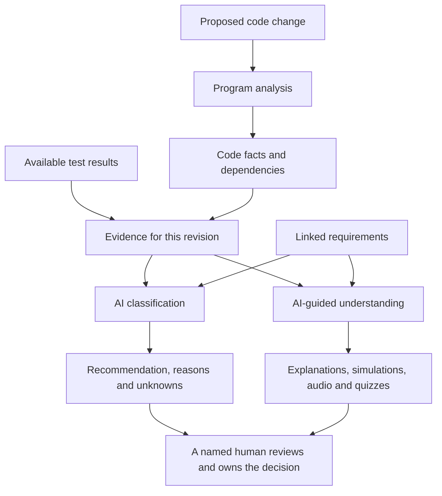
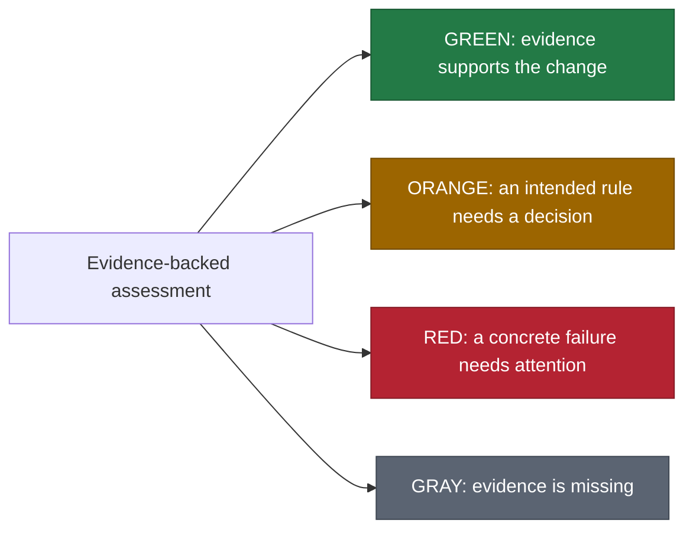

# Earned Trust in AI Code

A reference concept for [Tieto](https://www.tieto.com/)'s Junction 2026 challenge.

**AI reviews. Humans stay accountable.**

AI can produce code faster than people can understand it. Our idea is to make each review an inspectable explanation: what supports the change, what conflicts with its requirements, and what is still unknown.

## The Idea

AI is useful for interpreting intent and requirements. Program analysis is useful for checking concrete code facts. We combine these strengths instead of treating an AI opinion as proof.

The engine receives the proposed change, linked requirements, control-flow and data-flow facts, dependencies, and available test results. AI uses this evidence to assess support, contradictions, and missing information.

### Two Outputs, One Evidence Base

| Output | What it gives the reviewer |
| --- | --- |
| **Classification** | A recommendation for each changed block, its supporting evidence, confidence, conflicts, and unresolved questions. |
| **Understanding** | A way to inspect the consequence of a change, hear an explanation, and test their understanding before deciding. |

The classifier guides attention. The understanding tools help the reviewer judge what they find. Neither output gives approval on the human's behalf.

## Review Guidance

| Attention | Meaning |
| --- | --- |
| Green | The engine considers the change good to go within the available evidence; lighter human review is appropriate. |
| Orange | A requirement or business rule needs a human decision. |
| Red | A concrete conflict or failure needs attention. |
| Gray | Missing implementation or contract evidence prevents a complete assessment. |

**Orange asks for a decision. Gray asks for evidence.** A reviewer can settle an undecided business rule; they cannot make an unavailable dependency trustworthy merely by accepting it.

Every changed block is accounted for, but not every block needs the same depth of human inspection. Concrete failures and unresolved evidence cannot be overridden by a confidence score.

## A Review Is An Episode

1. Open the pull request and its requirement-linked engine findings.
2. Follow the review guidance through the changed blocks.
3. Answer policy questions, investigate failures, and identify missing evidence.
4. Use the simulation, audio, or quiz when a finding needs deeper understanding.
5. Return to GitHub with the checked scope, remaining unknowns, and risks. A named human makes the decision.

The prototype walkthrough visits four representative blocks. Its navigation remains visible from GitHub through the review experience and back again.

**More understanding of checkable evidence means more justified trust in the code.**

## Prototype Demo

- [Watch the prototype demo video](https://youtu.be/O6kLhf_FrNc)
- [Prototype implementation](classifier/)
- [Demonstration pull request](https://github.com/Krish-Waghresha/earned-review-demo/pull/4)
- [Engine review](https://github.com/Krish-Waghresha/earned-review-demo/pull/4#issuecomment-6885999395)

The synthetic C# example is a bulk invoice importer linked to requirement **INV-BULK-26**. It contains 1,618 added lines across 15 files. Real Roslyn analysis and local checks support the walkthrough: 87 checks pass and one intentionally reproduces duplicate persistence after a lost acknowledgement.

| Demonstrated case | What the viewer sees |
| --- | --- |
| Supported change | A green recommendation backed by the available analysis and checks. |
| Undecided policy | An orange question, a human answer, and an updated assessment. |
| Reproduced failure | A red finding made visible in a step-by-step simulation. |
| Missing dependency evidence | A gray request for the implementation or provider contract. |
| Human handoff | Findings tied to the reviewed commit, ready for a human review on GitHub. |

The recording ends ready to submit, not with an approval or merge. The demonstration repository requires GitHub access, and its interactive playground links are local to the presenter rather than a public deployment.

## Reference Scope

Program-analysis facts and the example's executable checks are real. AI judgments, confidence values, and interactive outcome mappings are authored reference inputs, not a live model evaluation or calibrated reliability measurements. Passing checks do not prove correctness, and unknowns are not silently accepted.

This is a reference implementation, not a finished product. It does not claim measured review-time savings or production safety. Findings stay tied to the analyzed revision, and only a human can give the final approval.

The central principle is simple: **more understanding of checkable evidence enables more justified trust in the code.**