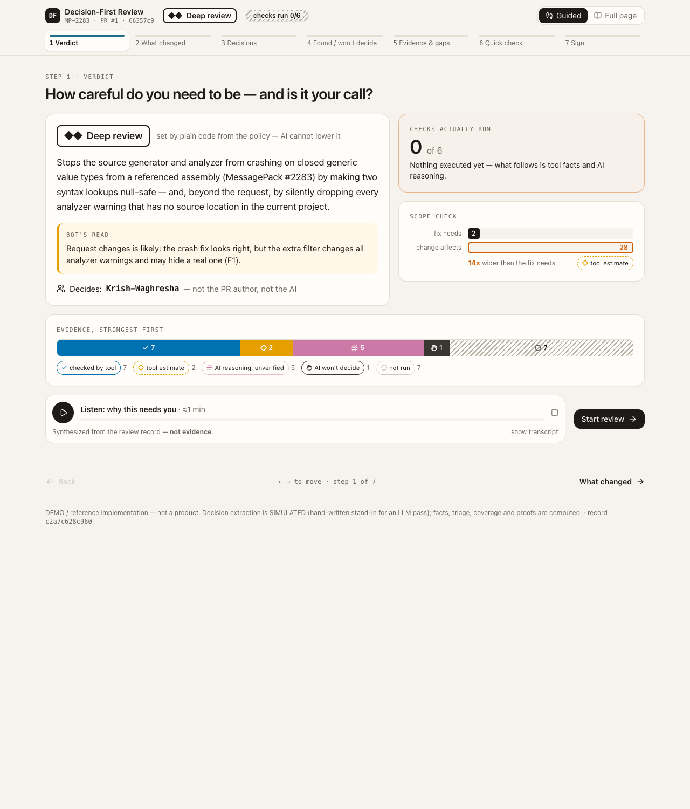
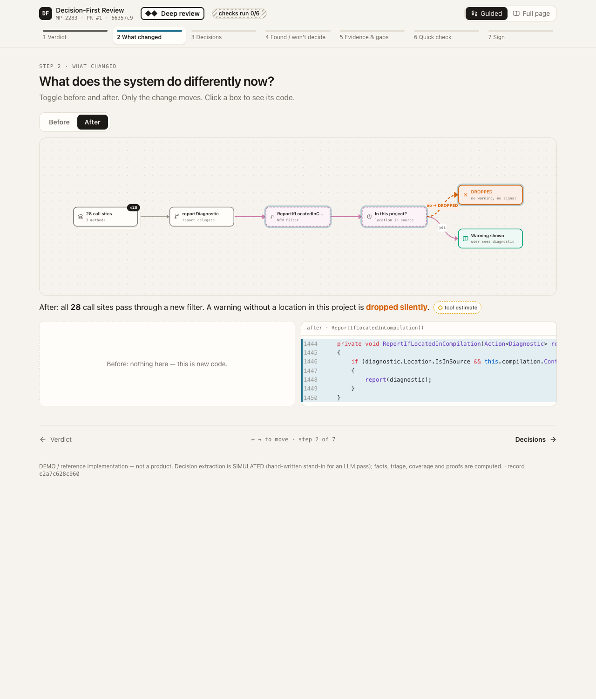
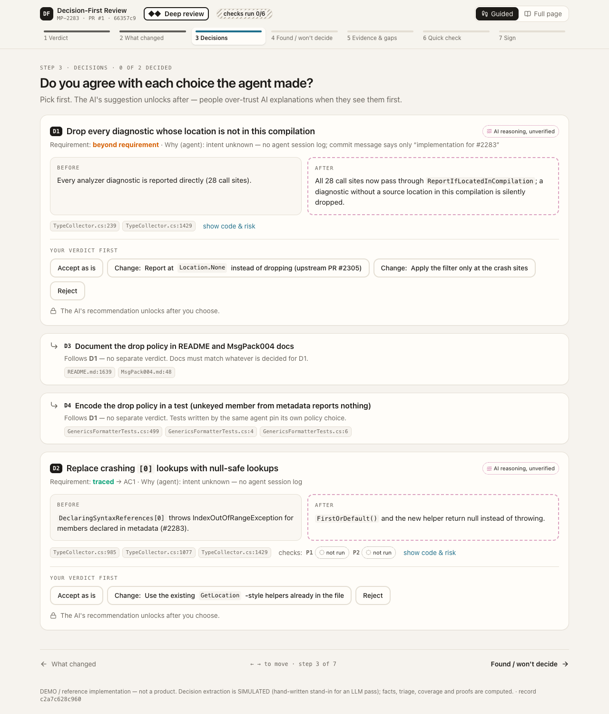
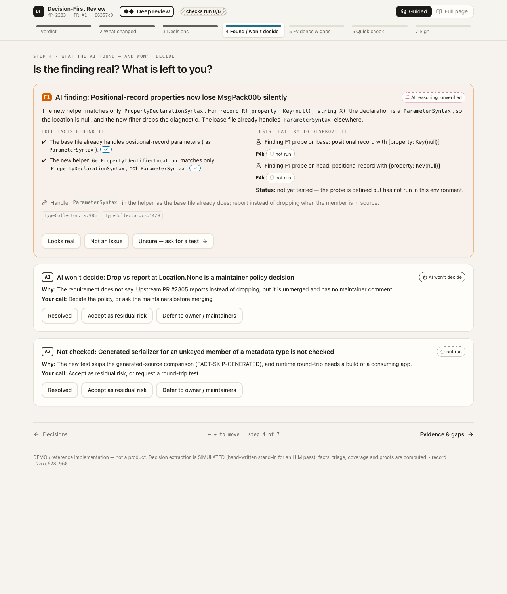
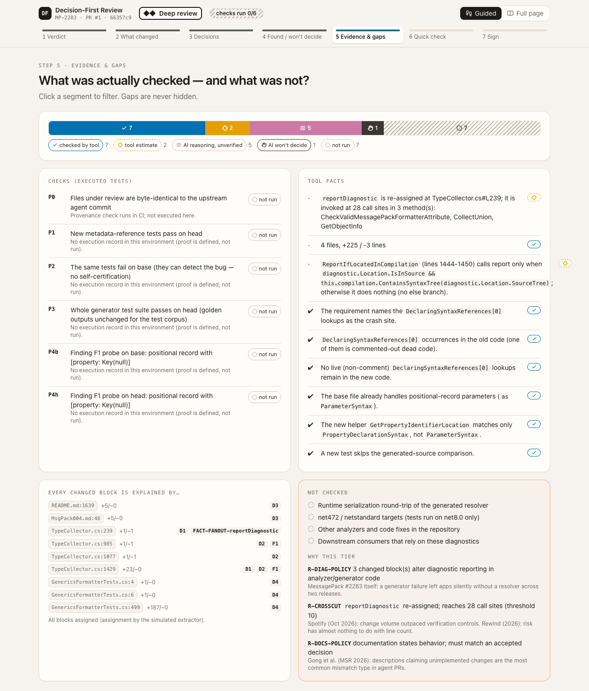
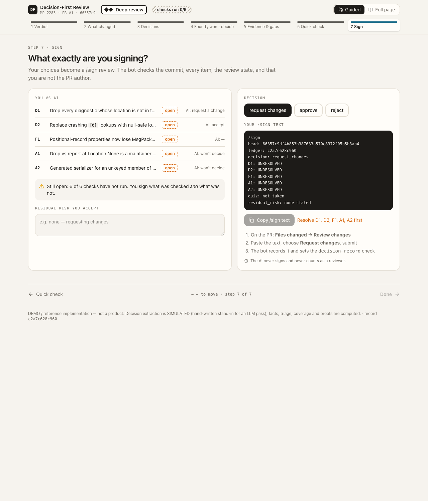
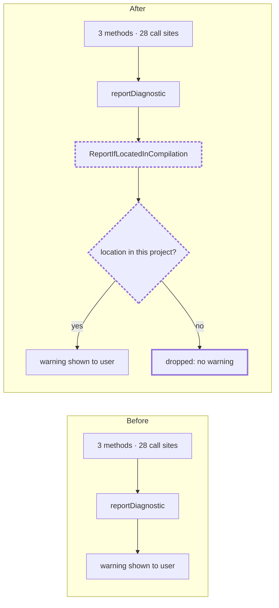

> **Interactive 7-step review (new):** download [`review-app.html`](review-app.html) and open it in a browser — guided steps, before/after flow graph, pick-before-reveal decisions, quiz, narrated briefing, sign form. Built from branch `demo/ui`. Rendered from a LOCAL run; proofs not executed.
>
> | 1 Verdict | 2 What changed | 3 Decisions |
> |---|---|---|
> |  |  |  |
> | **4 Found / won't decide** | **5 Evidence & gaps** | **7 Sign** |
> |  |  |  |

> **Rendered from a LOCAL run of the bot** (GitHub Actions not enabled on this repo). Proofs not executed. Interactive version: download `report.html` from this folder and open it in a browser (quiz, audio, sign form).

<!-- dfr:sticky -->
### 🟧 Deep review · ⚠️ Needs your decision on **4** items

**What this PR does:** Stops the source generator and analyzer from crashing on closed generic value types from a referenced assembly (MessagePack #​2283) by making two syntax lookups null-safe — and, beyond the request, by silently dropping every analyzer warning that has no source location in the current project.

**Bot's read:** Request changes is likely: the crash fix looks right, but the extra filter changes all analyzer warnings and may hide a real one (F1).

**Who decides:** `Krish-Waghresha` (area owner) — not the PR author, not the AI. The AI never approves.

**Checks run: 0 of 6** ⬜ — nothing has been executed yet; everything below is tool facts and AI reasoning.

> **Scope check** (🔶 tool estimate): The requirement asks to fix 2 crashing lookups. D1 changes how all 28 diagnostic call sites behave (14× wider than the fix needs).

**What to do**
1. Decide D1: keep dropping all diagnostics, narrow it to the crash sites, or report like PR #​2305 (A1 is a policy call).
2. Check finding F1 against its evidence (P4b, P4h): positional records may lose MsgPack005.
3. Accept A2 as residual risk or ask for a round-trip test.
4. Open the full report, answer 3 quick questions, press **Sign**, and submit the generated text as a PR review (*Request changes* or *Approve*).

<details><summary>Requirement `MP-2283` → decisions → checks</summary>

| Requirement | Covered by | Checks |
|---|---|---|
| **AC1** Generator and analyzer must not throw for a closed generic value type from a referenced assembly. | D2 | P1 ⬜ not run, P2 ⬜ not run |
| **AC2** The compiling assembly gets a generated resolver in that case. | D4 | P1 ⬜ not run |
| **AC3** Existing diagnostics for source-declared members are unchanged (no regression). | ⚠️ no decision | P3 ⬜ not run |

No decision claims AC3; only the full test suite (P3) speaks to it, and it does not cover diagnostics — see F1.

</details>

<details><summary><b>D1 · Drop every diagnostic whose location is not in this compilation</b> · 💬 AI reasoning, unverified</summary>

**Where:** [`TypeCollector.cs:239`](https://github.com/Krish-Waghresha/teito/blob/66357c9df4b853b387033a570c8372f05b5b3ab4/sample/src/MessagePack.SourceGenerator/CodeAnalysis/TypeCollector.cs#L239) · [`TypeCollector.cs:1429`](https://github.com/Krish-Waghresha/teito/blob/66357c9df4b853b387033a570c8372f05b5b3ab4/sample/src/MessagePack.SourceGenerator/CodeAnalysis/TypeCollector.cs#L1429)  
**Before:** Every analyzer diagnostic is reported directly (28 call sites).  
**After:** All 28 call sites now pass through `ReportIfLocatedInCompilation`; a diagnostic without a source location in this compilation is silently dropped.  
**Why (agent):** intent unknown — no agent session log; commit message says only “implementation for #​2283”  
**Requirement:** beyond requirement  
**If wrong:** Silent — users get no signal  
**Checks:** none yet  
**Alternatives:** Report at `Location.None` instead of dropping (upstream PR #​2305); Apply the filter only at the crash sites
  
↳ **D3 follows D1:** Document the drop policy in README and MsgPack004 docs ([`README.md:1639`](https://github.com/Krish-Waghresha/teito/blob/66357c9df4b853b387033a570c8372f05b5b3ab4/sample/README.md#L1639) · [`MsgPack004.md:48`](https://github.com/Krish-Waghresha/teito/blob/66357c9df4b853b387033a570c8372f05b5b3ab4/sample/doc/analyzers/MsgPack004.md#L48))
  
↳ **D4 follows D1:** Encode the drop policy in a test (unkeyed member from metadata reports nothing) ([`GenericsFormatterTests.cs:499`](https://github.com/Krish-Waghresha/teito/blob/66357c9df4b853b387033a570c8372f05b5b3ab4/sample/tests/MessagePack.SourceGenerator.Tests/GenericsFormatterTests.cs#L499) · [`GenericsFormatterTests.cs:4`](https://github.com/Krish-Waghresha/teito/blob/66357c9df4b853b387033a570c8372f05b5b3ab4/sample/tests/MessagePack.SourceGenerator.Tests/GenericsFormatterTests.cs#L4) · [`GenericsFormatterTests.cs:6`](https://github.com/Krish-Waghresha/teito/blob/66357c9df4b853b387033a570c8372f05b5b3ab4/sample/tests/MessagePack.SourceGenerator.Tests/GenericsFormatterTests.cs#L6))

</details>

<details><summary><b>D2 · Replace crashing `&#​91;0&#​93;` lookups with null-safe lookups</b> · 💬 AI reasoning, unverified</summary>

**Where:** [`TypeCollector.cs:985`](https://github.com/Krish-Waghresha/teito/blob/66357c9df4b853b387033a570c8372f05b5b3ab4/sample/src/MessagePack.SourceGenerator/CodeAnalysis/TypeCollector.cs#L985) · [`TypeCollector.cs:1077`](https://github.com/Krish-Waghresha/teito/blob/66357c9df4b853b387033a570c8372f05b5b3ab4/sample/src/MessagePack.SourceGenerator/CodeAnalysis/TypeCollector.cs#L1077) · [`TypeCollector.cs:1429`](https://github.com/Krish-Waghresha/teito/blob/66357c9df4b853b387033a570c8372f05b5b3ab4/sample/src/MessagePack.SourceGenerator/CodeAnalysis/TypeCollector.cs#L1429)  
**Before:** `DeclaringSyntaxReferences&#​91;0&#​93;` throws IndexOutOfRangeException for members declared in metadata (#​2283).  
**After:** `FirstOrDefault()` and the new helper return null instead of throwing.  
**Why (agent):** intent unknown — no agent session log  
**Requirement:** traced → AC1  
**If wrong:** Safe — removes an exception path  
**Checks:** P1 ⬜ not run, P2 ⬜ not run  
**Alternatives:** Use the existing `GetLocation`-style helpers already in the file

</details>

<details><summary><b>F1 · AI finding: Positional-record properties now lose MsgPack005 silently</b> · 💬 AI reasoning backed by tool facts — test not run yet</summary>

**Where:** [`TypeCollector.cs:985`](https://github.com/Krish-Waghresha/teito/blob/66357c9df4b853b387033a570c8372f05b5b3ab4/sample/src/MessagePack.SourceGenerator/CodeAnalysis/TypeCollector.cs#L985) · [`TypeCollector.cs:1429`](https://github.com/Krish-Waghresha/teito/blob/66357c9df4b853b387033a570c8372f05b5b3ab4/sample/src/MessagePack.SourceGenerator/CodeAnalysis/TypeCollector.cs#L1429)  
The new helper matches only `PropertyDeclarationSyntax`. For `record R(&#​91;property: Key(null)&#​93; string X)` the declaration is a `ParameterSyntax`, so the location is null, and the new filter drops the diagnostic. The base file already handles `ParameterSyntax` elsewhere.

**Tool facts behind it:** ✅ The base file already handles positional-record parameters (`as ParameterSyntax`).; ✅ The new helper `GetPropertyIdentifierLocation` matches only `PropertyDeclarationSyntax`, not `ParameterSyntax`.

**Tests that try to disprove it:** P4b Finding F1 probe on base: positional record with &#​91;property: Key(null)&#​93; — ⬜ not run No execution record in this environment (proof is defined, not run).; P4h Finding F1 probe on head: positional record with &#​91;property: Key(null)&#​93; — ⬜ not run No execution record in this environment (proof is defined, not run).

**Fix hint:** Handle `ParameterSyntax` in the helper, as the base file already does; report instead of dropping when the member is in source.

</details>

<details><summary><b>A1 · AI won't decide: Drop vs report at Location.None is a maintainer policy decision</b></summary>

**Why:** The requirement does not say. Upstream PR #​2305 reports instead of dropping, but it is unmerged and has no maintainer comment.  
**You decide:** Decide the policy, or ask the maintainers before merging.

</details>

<details><summary><b>A2 · Not checked — needs your call: Generated serializer for an unkeyed member of a metadata type is not checked</b></summary>

**Why:** The new test skips the generated-source comparison (FACT-SKIP-GENERATED), and runtime round-trip needs a build of a consuming app.  
**You decide:** Accept as residual risk, or request a round-trip test.

</details>

<details><summary>Flow before → after (🔶 tool estimate from a text-level parse)</summary>



</details>

<details><summary>Why 🟧 Deep review, coverage, what was not checked</summary>

**Why this tier:** `R-DIAG-POLICY` 3 changed block(s) alter diagnostic reporting in analyzer/generator code; `R-CROSSCUT` `reportDiagnostic` re-assigned; reaches 28 call sites (threshold 10); `R-DOCS-POLICY` documentation states behavior; must match an accepted decision  
**Coverage:** every changed block is assigned to a card or a tool fact (assignment by the simulated extractor)  
**Not checked:** Runtime serialization round-trip of the generated resolver; net472 / netstandard targets (tests run on net8.0 only); Other analyzers and code fixes in the repository; Downstream consumers that rely on these diagnostics

</details>

---
## Checks

| ID | Check | Result | Detail |
|---|---|---|---|
| P0 | Files under review are byte-identical to the upstream agent commit | ⬜ not run | Provenance check runs in CI; not executed here. |
| P1 | New metadata-reference tests pass on head | ⬜ not run | No execution record in this environment (proof is defined, not run). |
| P2 | The same tests fail on base (they can detect the bug — no self-certification) | ⬜ not run | No execution record in this environment (proof is defined, not run). |
| P3 | Whole generator test suite passes on head (golden outputs unchanged for the test corpus) | ⬜ not run | No execution record in this environment (proof is defined, not run). |
| P4b | Finding F1 probe on base: positional record with &#​91;property: Key(null)&#​93; | ⬜ not run | No execution record in this environment (proof is defined, not run). |
| P4h | Finding F1 probe on head: positional record with &#​91;property: Key(null)&#​93; | ⬜ not run | No execution record in this environment (proof is defined, not run). |

## Tool facts

| Fact | Kind | Holds |
|---|---|---|
| `reportDiagnostic` is re-assigned at TypeCollector.cs#​L239; it is invoked at 28 call sites in 3 method(s): CheckValidMessagePackFormatterAttribute, CollectUnion, GetObjectInfo | 🔶 tool estimate | n/a (measurement) |
| 4 files, +225 / -3 lines | ✅ checked by tool | n/a (measurement) |
| `ReportIfLocatedInCompilation` (lines 1444-1450) calls report only when `diagnostic.Location.IsInSource &amp;&amp; this.compilation.ContainsSyntaxTree(diagnostic.Location.SourceTree)`; otherwise it does nothing (no else branch). | 🔶 tool estimate | n/a (measurement) |
| The requirement names the `DeclaringSyntaxReferences&#​91;0&#​93;` lookups as the crash site. | ✅ checked by tool | yes |
| `DeclaringSyntaxReferences&#​91;0&#​93;` occurrences in the old code (one of them is commented-out dead code). | ✅ checked by tool | yes |
| No live (non-comment) `DeclaringSyntaxReferences&#​91;0&#​93;` lookups remain in the new code. | ✅ checked by tool | yes |
| The base file already handles positional-record parameters (`as ParameterSyntax`). | ✅ checked by tool | yes |
| The new helper `GetPropertyIdentifierLocation` matches only `PropertyDeclarationSyntax`, not `ParameterSyntax`. | ✅ checked by tool | yes |
| A new test skips the generated-source comparison. | ✅ checked by tool | yes |

## Changed blocks and what explains them

| Block | +/− | Explained by |
|---|---|---|
| [`README.md:1639`](https://github.com/Krish-Waghresha/teito/blob/66357c9df4b853b387033a570c8372f05b5b3ab4/sample/README.md#L1639) | +5/−0 | D3 |
| [`MsgPack004.md:48`](https://github.com/Krish-Waghresha/teito/blob/66357c9df4b853b387033a570c8372f05b5b3ab4/sample/doc/analyzers/MsgPack004.md#L48) | +5/−0 | D3 |
| [`TypeCollector.cs:239`](https://github.com/Krish-Waghresha/teito/blob/66357c9df4b853b387033a570c8372f05b5b3ab4/sample/src/MessagePack.SourceGenerator/CodeAnalysis/TypeCollector.cs#L239) | +1/−1 | D1, FACT-FANOUT-reportDiagnostic |
| [`TypeCollector.cs:985`](https://github.com/Krish-Waghresha/teito/blob/66357c9df4b853b387033a570c8372f05b5b3ab4/sample/src/MessagePack.SourceGenerator/CodeAnalysis/TypeCollector.cs#L985) | +1/−1 | D2, F1 |
| [`TypeCollector.cs:1077`](https://github.com/Krish-Waghresha/teito/blob/66357c9df4b853b387033a570c8372f05b5b3ab4/sample/src/MessagePack.SourceGenerator/CodeAnalysis/TypeCollector.cs#L1077) | +1/−1 | D2 |
| [`TypeCollector.cs:1429`](https://github.com/Krish-Waghresha/teito/blob/66357c9df4b853b387033a570c8372f05b5b3ab4/sample/src/MessagePack.SourceGenerator/CodeAnalysis/TypeCollector.cs#L1429) | +23/−0 | D1, D2, F1 |
| [`GenericsFormatterTests.cs:4`](https://github.com/Krish-Waghresha/teito/blob/66357c9df4b853b387033a570c8372f05b5b3ab4/sample/tests/MessagePack.SourceGenerator.Tests/GenericsFormatterTests.cs#L4) | +1/−0 | D4 |
| [`GenericsFormatterTests.cs:6`](https://github.com/Krish-Waghresha/teito/blob/66357c9df4b853b387033a570c8372f05b5b3ab4/sample/tests/MessagePack.SourceGenerator.Tests/GenericsFormatterTests.cs#L6) | +1/−0 | D4 |
| [`GenericsFormatterTests.cs:499`](https://github.com/Krish-Waghresha/teito/blob/66357c9df4b853b387033a570c8372f05b5b3ab4/sample/tests/MessagePack.SourceGenerator.Tests/GenericsFormatterTests.cs#L499) | +187/−0 | D4 |

## Quick check (answers in the folds)

**Q1. How many call sites now pass through the new filter?**
- A) 2
- B) 28
- C) 34

<details><summary>Answer</summary>28 — 🔶 tool estimate: Counted by the bot from the head file (FACT-FANOUT-reportDiagnostic).</details>

**Q2. Which changed line makes the filter apply to every diagnostic?**
- A) TypeCollector.cs#​L239
- B) TypeCollector.cs#​L985
- C) TypeCollector.cs#​L1077
- D) TypeCollector.cs#​L1429

<details><summary>Answer</summary>TypeCollector.cs#​L239 — 🔶 tool estimate: The constructor wraps the single reportDiagnostic delegate (FACT-FANOUT-reportDiagnostic).</details>

**Q3. Before this change, what happened for a positional record property with `&#​91;property: Key(null)&#​93;`?**
- A) The analyzer crashed (AD0001)
- B) MsgPack005 was reported
- C) Nothing was reported

<details><summary>Answer</summary>The analyzer crashed (AD0001) — 💬 AI reasoning, unverified: Expected from reading the code; the probe on the old code (P4b) has not run yet, so this key is AI reasoning.</details>

**Q4. In one sentence: what could break for users if this merges as is?**
_Free text — write it in your /sign review as `could_break:`_

## Sign

Copy, keep one value per line, and submit as a PR review (**Request changes** or **Approve**, matching `decision`).

```text
/sign
head: 66357c9df4b853b387033a570c8372f05b5b3ab4
ledger: dee16d9b18fb
decision: request_changes
D1: accept|request_change|reject
D2: accept|request_change|reject
F1: valid|invalid
A1: resolved|accept_risk|defer
A2: resolved|accept_risk|defer
quiz: 3/3
could_break: <one sentence>
residual_risk: <what you accept>
```

<sub>Decision-First Review (demo, not a product) · tier and facts computed by plain code from the base-revision policy · decision cards are AI reasoning (simulated extractor in this demo) · evidence record `dee16d9b18fb`</sub>