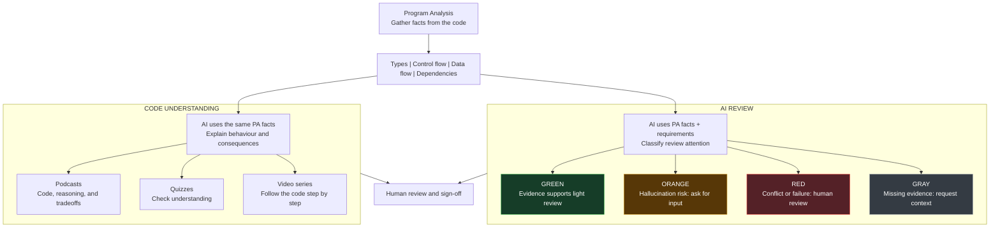

# Earned Trust in AI Code: Script and Storyboard

Working draft. Timings are rehearsal estimates, not a fixed presentation limit.

## Story Arc

The stakes -> the vibe-coding video -> the understanding gap -> taking control back -> program analysis + AI -> the cross-tenant cache reveal -> two outcomes -> project demo -> human sign-off.

## 1. Opening: The Stakes

**Duration:** 5-6 seconds.

**Screen:** Black background. Reveal the number first, then the supporting lines.

> 30,246 tracked service incidents.
>
> In just six months.
>
> Across 1,082 cloud and SaaS providers.

**Small source line:** January-June 2026. IncidentHub, H1 2026 Cloud and SaaS Reliability Report. Includes degraded performance and minor incidents.

**Audio:** Silence or a restrained sound cue. Let the number land.

**Transition:** Cut to the next title card. Do not add a claim that AI caused these incidents.

## 2. Meanwhile: The Video

**Duration:** 2-second title card, then the existing 10-second video.

**Screen:**

> Meanwhile, developers at big corporations...

**Action:** Play the team's staged video: a vibe coder asking Claude to fix bugs.

**Audio:** Use the video's own dialogue. No voice-over on top of the joke.

**Transition:** Freeze on the last frame or cut to a pull request. Leave one beat of silence.

## 3. From Generating to Reviewing

**Duration:** About 15 seconds.

**Screen:** A pull request waiting for review. Reveal:

> Who understands the fix?

**Speaker:**

> "The AI says it's fixed. Now someone has to approve it.
>
> We're chasing speed, not understanding. And when we merge code nobody understands, we're merging time bombs. We just don't know when they'll go off."

**Delivery:** The joke is over. Slow down on "someone has to approve it."

## 4. The Truth

**Duration:** About 15 seconds.

**Screen:**

> Developers are not in control.

**Speaker:**

> "The truth is, developers are not in control."

**Pause:** Two seconds. Do not qualify or soften this line.

**Speaker continues:**

> "The way to take control back is to make understanding of code obvious, and make code reviews more honest and accurate."

**Screen transition:** Replace the headline with:

> Understanding. Evidence. Accountability.

## 5. How Do We Do That?

**Duration:** About 25 seconds.

**Screen:** Start with "How?" Then reveal "Program Analysis."

**Speaker:**

> "How do we do that?
>
> The foundation isn't new. It comes from decades of program-analysis research.
>
> AI can give you a convincing explanation. But convincing is not the same as verified.
>
> Instead of asking it to guess its way through branches, data flow, and dependencies, we give it concrete evidence from the code."

**Screen:** Under Program Analysis, reveal four short labels:

- Types and signatures
- Control flow
- Data flow
- Calls and dependencies

## 6. A Scoped Query, An Unscoped Cache

**Duration:** About 60 seconds.

**Requirement:** A tenant must only receive its own invoices.

**Setup:** The cache is shared across requests from different tenants. Invoice numbers are unique within a tenant, not globally. Start with an empty cache; both Tenant A and Tenant B have an invoice numbered `INV-42`. The repository correctly filters by tenant, and there is no additional tenant check on the cached return value.

**Screen:** Show this code. Initially highlight only the tenant-scoped repository call.

```csharp
Invoice GetInvoice(string tenantId, string invoiceNumber)
{
    var key = BuildKey(invoiceNumber);

    if (cache.TryGetValue(key, out var cached))
        return cached;

    var invoice = repository
        .ForTenant(tenantId)
        .Get(invoiceNumber);

    cache[key] = invoice;
    return invoice;
}

string BuildKey(string number)
    => number.Trim().ToUpperInvariant();
```

**Speaker:**

> "Look at this query. It explicitly filters by tenant.
>
> But a correct database query does not make the whole method safe."

**Screen:** Reveal the PA findings beside the code, one at a time.

| Technique | Evidence | Highlight |
| --- | --- | --- |
| Call graph | `GetInvoice` calls `BuildKey` and the tenant-scoped repository. | Connect the caller, helper, and repository call. |
| Data-flow analysis | The cache key depends on `invoiceNumber`, not `tenantId`. | Trace `invoiceNumber` through `BuildKey` into `key`. |
| Control-flow analysis | A cache hit returns before the repository call. | Highlight `return cached` and the skipped database path. |
| State/effect analysis | The shared cache retains one request's result for subsequent requests. | Keep the cache visible between the two requests. |

**Speaker:**

> "Program analysis gives the AI three connected facts: the key ignores the tenant, a cache hit skips the database, and the cached value survives between requests.
>
> AI connects those facts to the requirement: a tenant must only receive its own invoices.
>
> Now we have a two-request counterexample to test."

**Screen:** Animate these requests in sequence. Keep the same cache entry visible throughout.

| Request | Path | Result under this setup |
| --- | --- | --- |
| Tenant A requests `INV-42`. | Cache miss. Load A's invoice. Store it under `INV-42`. | Tenant A receives its own invoice. |
| Tenant B requests `INV-42`. | Cache hit. Return immediately. Never query B's repository. | **Tenant B receives Tenant A's invoice.** |

**Speaker:**

> "Tenant A loads invoice forty-two. The cache stores it.
>
> Tenant B asks for its invoice forty-two. Same key. Cache hit. Tenant A's invoice comes back. The database is never reached."

**Screen reveal:**

> The tenant boundary exists in the database path.
>
> The cache-hit path bypasses it.

**Speaker:**

> "PA exposes the paths and dependencies. AI connects them to the security requirement and proposes the failure scenario. A sequential test can check the claim."

**Transition:** Collapse the code and trace into the Program Analysis block of the architecture diagram.

## 7. Our Idea: One Foundation, Two Outcomes

**Duration:** About 45-60 seconds.

**Screen layout:** Program Analysis at the top gathers the facts. Split the facts into two parallel columns: **AI Review** on the left and **Code Understanding** on the right. Each column has its own AI step receiving the same facts. Do not put the learning formats downstream of the colour classifier.



**Reveal 1: Gather the facts.** Show Program Analysis and the fact labels. Briefly carry over the cache example's three findings as concrete evidence.

**Speaker:**

> "First, we gather facts from program analysis. The types. The paths. How data moves. What the code depends on.
>
> Those facts feed two parallel flows."

**Reveal 2: AI review.** Light up the left arrow and its AI block. Reveal the four coloured outputs one at a time as they are named. Put the colour name and meaning inside each output; do not rely on colour alone.

**Speaker:**

> "On the first side, AI uses the facts and requirements to classify the change into four colours.
>
> Green: the evidence supports light review.
>
> Orange: hallucination risk. An assumption needs your input, not an invented answer.
>
> Red: a conflict or failure needs human review.
>
> Gray: the evidence is missing. Get the context before making the call."

**Colour key for the slide:**

| Colour | Meaning | Reviewer action |
| --- | --- | --- |
| Green | Evidence supports the assessed behaviour. | Light review and spot-check the evidence. |
| Orange | Unconfirmed assumptions create hallucination risk. | Answer the specific clarification question. |
| Red | A requirement conflict or concrete failure is identified. | Inspect the behaviour and resolve the finding. |
| Gray | Required implementation or evidence is unavailable. | Supply the missing context or contract. |

**Reveal 3: Code understanding.** Keep the entire left branch visible. Light up a second arrow from the same fact block into the right-hand AI block, then reveal Podcasts, Quizzes, and Video series.

**Speaker:**

> "In parallel, AI gets those same facts and turns them into understanding.
>
> Podcasts that explain the code and its tradeoffs. Quizzes that challenge what you think you understand. Video series that follow the behaviour step by step.
>
> The facts are the foundation for both the review and the explanation."

**Reveal 4: The human decision.** Bring both branches into the final human review and sign-off block.

**Speaker, as the branches meet:**

> "One flow tells you where to look. The other helps you understand what you're looking at.
>
> The human owns the merge."

## 8. Transition Into the Demo

**Duration:** About 10 seconds.

**Screen:** Switch from the left-hand four-colour branch to the PR review graph. When opening the red card's learning tools later, briefly recall the parallel Code Understanding branch.

**Speaker:**

> "Let's follow one pull request: a bulk invoice importer.
>
> We'll see where the evidence supports confidence, where the review needs human input, and where one retry can save the same invoice twice."

## 9. Demo Story Beats

These are the demo cues to rehearse next. Do not turn this into a tour of every button.

| Beat | On-screen action | Spoken line |
| --- | --- | --- |
| Start with the whole change | Show the module graph and the 1,618-added-line PR summary. | "This is one change across fifteen files. The reviewer needs to know where their attention matters." |
| Evidence-backed confidence | Open a green module such as BatchReconciler, then briefly open View analysis. | "Green is not just formatting. This is reconciliation logic. The review connects its findings to the requirement and the analysis behind them." |
| An assumption becomes a question | Open DuplicatePolicy while it is orange. Show Hallucination risk and its clarification question. | "Should a cancelled invoice block re-import? The code has an answer. The requirement doesn't. An AI shouldn't invent that business rule." |
| Human input changes the assessment | Choose Yes, block cancelled invoices, then Save answer & recompute. | "The reviewer supplies the missing policy. Now the assessment has that context." |
| A concrete failure | Open RetryingInvoiceWriter, then Understand. | "Here, the problem isn't an unanswered policy question. The retry can create a duplicate." |
| Follow the behaviour | Run the Simulation. Point to the first saved record, lost confirmation, and second ID. | "The first invoice is already stored. The confirmation is lost. The retry creates a new ID, so the same invoice becomes a second record." |
| Compare a repair | Switch to Proposed fix. | "Keeping the identity stable lets this store recognize the same record. The storage guarantee still matters." |
| Explain and check understanding | Briefly show Listen to your code and Take a quiz. | "The reviewer can hear the code and its tradeoffs explained, then test their understanding. These aren't approval buttons." |
| Refuse to guess | Briefly show TaxGateway if time allows. | "When the implementation is selected at runtime and its contract is missing, the review asks for context. It doesn't pretend to know." |
| Return accountability to the reviewer | Open Overall sign-off. Show the commit, unresolved findings, acknowledgment, and Continue to GitHub. | "The findings travel with the exact revision. The reviewer acknowledges them, and the final sign-off happens on GitHub under their own account." |

## 10. Closing

**Screen:**

> AI reviews. Humans stay accountable.

**Speaker:**

> "AI can write the code. It cannot take responsibility for your merge.
>
> Take control back: understand the change, question the assumptions, and own the decision."

## Presenter Notes: Not Spoken

### Opening Source

- [IncidentHub: H1 2026 Cloud and SaaS Reliability Report](https://blog.incidenthub.cloud/h1-2026-cloud-saas-reliability-report), updated October 7, 2026.
- Scope: January 1-June 30, 2026; a fixed set of 1,082 continuously monitored providers.
- The 30,246 count is based on provider status-page incidents, including degraded performance, minor issues, and major issues. Maintenance is excluded.
- This is not a census of all worldwide outages, a count of unique underlying failures, or evidence that AI-generated code caused these incidents.
- Do not compare this count with Uptime Institute's selected public-outage reports as if their definitions and coverage were the same.

### Technical Wording

- Use "decades of program-analysis research," not "more than 80 years old" without a specific historical reference.
- Program-analysis facts ground the explanation; they do not prove arbitrary software correct or eliminate all hallucinations.
- The cache example is separate from the bulk-invoice PR. Establish the cache's shared lifetime from its implementation and application configuration. Without that evidence, the cross-tenant leak remains a hypothesis.
- For the cache counterexample, run the two requests against the same cache instance. Resetting the cache between requests removes the condition that exposes the bug. Do not label a proposed trace as an executed result.
- The cache example demonstrates complementary evidence and reasoning, not that AI alone could never notice the bug. A fuller PA pipeline is needed to establish shared state across requests; a call graph alone does not establish it.
- Orange means hallucination risk from unconfirmed assumptions, not a proven hallucination in every orange method.
- Keep the two outcomes distinct: evidence-led AI review and understandable explanations for the human reviewer.
- The architecture shows two consumers of PA facts: an AI classifier and an AI explanation generator. The second branch does not depend on a colour being assigned first.
- Colours route attention; they are not code-size categories or automatic approval. A green finding is scoped to its evidence, and orange is a risk of unsupported reasoning rather than a proven hallucination.
- Podcasts, quizzes, and video series are concept outputs. In the current demo, show Listen to your code, Take a quiz, and the interactive Simulation; do not describe a video-series feature as already implemented.
- The stable-ID repair depends on the store's idempotency and conflict-handling guarantees. Do not present it as universal exactly-once execution.

### Demo Preparation

- Demo PR: [INV-BULK-26 #3](https://github.com/Krish-Waghresha/earned-review-demo/pull/3).
- Confirm the browser is signed into an account with access to the private repository. A PR author cannot approve their own PR; use a second authorized reviewer or demonstrate a comment.
- Start at the overview for the module-based demo. Pause the method walkthrough if it is active.
- Check DuplicatePolicy is orange before rehearsing the clarification beat. A previously saved answer can change its displayed state. Preserve existing notes unless deliberately resetting the example.
- Keep the lost-confirmation case selected in the simulation, with Current code active before starting it.
- The narration is approximately 1 minute 42 seconds. Use only a short excerpt during the pitch unless the time budget allows the full explanation.
- The quiz has six questions. Demonstrate one question and its feedback rather than taking the full quiz on stage.
- Continue to GitHub copies the summary and opens the PR. Paste it into Review changes and submit manually. Do not imply that opening GitHub has already submitted or approved anything.

### Points for Questions

- What makes us withhold confidence? Missing context, conflicting evidence, unresolved dependencies, and concrete failures.
- Who owns the decision? The human reviewer submitting on GitHub.
- How would we measure the concept? Review time alongside missed defects, reverts, incidents, accepted findings, and the share of changes routed to humans. These are evaluation measures, not claimed improvements from this demo.